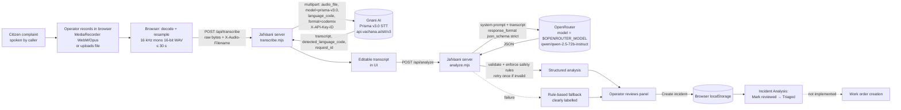
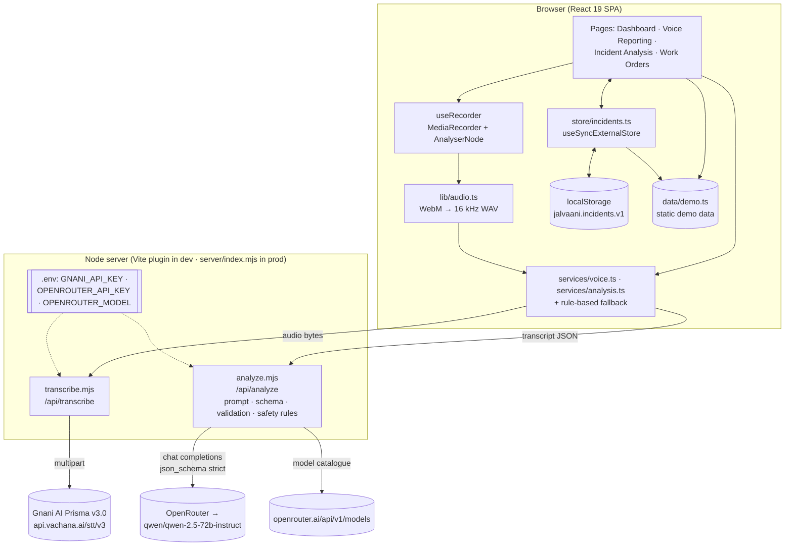

# JalVaani — Project Audit & Technical Documentation

> **Audit date:** 2026-11-10  ·  **Codebase version:** `jalvaani@0.1.0` (not under git)  ·  **Auditor scope:** every file under `E:\Jalvaani` except `node_modules/` and `dist/`.
> This report was produced by reading the source and by referencing live tests that were run during this development session. **No application files were modified to produce it.** Secret values are never shown; environment variables are named only.

**Evidence labels used throughout**

| Label | Meaning |
|---|---|
| **LIVE-API** | Exercised against the real external API (Gnani or OpenRouter) during this development session; request IDs recorded. |
| **LIVE-UI** | Exercised end-to-end in a browser against the running app during this session. |
| **USER-REPORTED** | Reported by the project owner; not independently reproduced by the auditor. |
| **CODE** | Verified by code inspection only. |
| **NONE** | No evidence beyond the UI existing. |

There is **no automated test suite** in the repository. All "tested" claims below refer to manual/scripted checks performed during the session, whose raw outputs live in the session scratchpad, **not in the repo**.

---

## 1. Executive summary

JalVaani is a working hackathon prototype of a **voice-first incident intake system for a municipal water utility**. A control-room operator records (or uploads) a citizen's complaint in Hindi, English or Hinglish; the audio is transcribed by **Gnani AI's Prisma v3.0** speech-to-text; the transcript is then analysed by a **third-party LLM via OpenRouter** (`qwen/qwen-2.5-72b-instruct`) into a validated, structured incident record with severity, location, verification-first recommended actions and missing information; an operator must review it before triage.

**What is genuinely working (live-tested):** browser recording → WAV conversion → Gnani Prisma v3.0 transcription → editable transcript → OpenRouter structured analysis with server-side validation and safety enforcement → incident creation → incident review. Error, timeout, retry and rule-based fallback paths exist and the key ones were exercised.

**What is not real yet:** work orders are not created from incidents (the button only navigates); work-order changes are not persisted; dashboard trend charts and several KPIs are static demo data; there is no database, no authentication, no automated tests, no deployment configuration. Persistence is browser `localStorage` only.

The strongest part of the project is the **safety design of the AI layer**: the model never gets the last word — the server validates every field, drops unsupported evidence, caps or floors severity by rule, moves unconditional dispatch actions behind verification, and forces human review.

---

## 2. Problem statement

Indian urban water utilities receive large volumes of complaints (leaks, bursts, no supply, low pressure, contamination) by phone, often in Hindi or Hinglish, with vague locations. Control-room staff must transcribe, classify, prioritise and decide whether to dispatch crews. Errors in both directions are costly: under-rating contamination risks public health; dispatching crews on unverified or vague reports wastes scarce field capacity.

JalVaani targets the **intake and triage** stage: turn a spoken complaint into a structured, prioritised, reviewable incident quickly, without letting an AI make unverified dispatch decisions.

---

## 3. Product overview

A single-page web application ("Water Operations Command") with four sections:

| Page | Route | Purpose |
|---|---|---|
| Dashboard | `/` | Operational overview: KPIs, intake chart, zone health, priority queue, field response |
| Voice Reporting | `/voice` | Record/upload complaint → Gnani transcription → edit → AI analysis → create incident |
| Incident Analysis | `/analysis`, `/analysis/:incidentId` | Trend charts, filterable incident list, incident detail with AI analysis and human review |
| Work Orders | `/work-orders` | Table/board of work orders, crew assignment, status progression, crew roster |

A small Node server provides two API groups: `/api/transcribe` (Gnani proxy) and `/api/analyze` (OpenRouter proxy).

---

## 4. Complete feature inventory

Status key: **✅ Implemented & tested** (LIVE-API / LIVE-UI evidence) · **🟡 Implemented, not fully tested** · **🟠 Partial** · **⚪ UI-only / mock** · **❌ Planned, not implemented**

### 4.1 Dashboard and analytics

| Feature | What it does | Implementation | Status |
|---|---|---|---|
| Active-incident count | Counts non-resolved incidents | `DashboardPage.tsx` from `useIncidents()` store (includes newly created incidents) | ✅ (LIVE-UI: count changed 7→8 in sidebar after creation) |
| Households affected KPI | Sum of `affectedHouseholds` of active incidents | Computed from store | 🟡 CODE |
| KPI deltas (`+3`, `−12%`, `−0.6h`, `+8 pts`) | Trend indicators | **Hard-coded strings** in `DashboardPage.tsx:62-65` | ⚪ mock |
| Mean time to resolve "4.1h" | MTTR | **Hard-coded** `value="4.1h"` | ⚪ mock |
| Voice-reported % | Share of voice channel | Computed from store | 🟡 CODE |
| 24-hour intake chart | Voice vs other reports by hour | `hourlyIntake` generated formula in `demo.ts:298` | ⚪ mock |
| Zone health panel | Pressure / supply per zone | Static `zones` in `demo.ts` | ⚪ mock (no SCADA) |
| Priority queue | Open incidents sorted by severity then recency | Store + `severityRank` | ✅ LIVE-UI |
| Critical-incident banner | Lists critical open incidents | Computed from store | 🟡 CODE |
| Field response panel | Active work orders | Static `workOrders` seed (not the Work Orders page state) | ⚪ mock |
| Weekly trend / category / language-mix charts | Analytics on Incident Analysis page | Static arrays `weeklyTrend`, `categoryBreakdown`, `languageMix` | ⚪ mock |

### 4.2 Voice reporting

| Feature | What it does | Implementation | Status |
|---|---|---|---|
| Language selection | Hindi+English / Hindi / English | `languageOptions` → `hi-IN,en-IN` / `hi-IN` / `en-IN` (`services/voice.ts:17-19`) | ✅ LIVE-API (`hi-IN,en-IN`); single codes 🟡 |
| Rajasthani removed | Not in documented Prisma v3.0 list | Removed from selector and demo data | ✅ CODE |
| Four-step stepper | Capture → Transcribe → Understand → Create incident | `VoiceReportingPage.tsx` phase machine | ✅ LIVE-UI |
| Service status badges | Shows Gnani and OpenRouter config/model state | `GET /api/transcribe/status`, `GET /api/analyze/status` | ✅ LIVE-UI (incl. "model not found" state) |
| Setup banner when key missing | Red banner with instructions; record/upload disabled | `service.configured === false` | ✅ LIVE-UI |
| Recent voice reports list | Latest voice-channel incidents | From store | 🟡 CODE |

### 4.3 Audio recording and processing

| Feature | What it does | Implementation | Status |
|---|---|---|---|
| Microphone capture | Records via `MediaRecorder` (mono, echo cancellation, noise suppression) | `hooks/useRecorder.ts` | 🟡 Recording pipeline LIVE-UI-tested with a **synthetic oscillator stream**; real-voice mic use **USER-REPORTED** (owner tested a real Hindi complaint) |
| Live waveform | RMS level from `AnalyserNode` | `useRecorder.ts` + `Waveform` component | 🟡 CODE |
| 30 s auto-stop + countdown | Enforces Gnani REST limit | `useRecorder(MAX_AUDIO_SECONDS)`; last-5 s warning | 🟡 CODE (not observed live) |
| WebM/Opus → 16 kHz mono 16-bit WAV | Browser output is not a documented Prisma format | `lib/audio.ts` `toWav16kMono()` via `OfflineAudioContext` | ✅ LIVE-UI (verified header: 16000 Hz, 1 ch, 16-bit) |
| File upload | WAV/MP3/OGG/FLAC/AAC/M4A, ≤30 s checked client-side | `handleUpload()` + `getAudioDuration()` | ✅ LIVE-UI (WAV); other formats 🟡 |
| Server-side duration check | Rejects WAV > 30 s from header | `wavDurationSec()` in `transcribe.mjs` | ✅ LIVE (35 s WAV → 400 `MAX_AUDIO_DURATION_EXCEEDED`) |
| Non-WAV duration check on server | — | Not implemented (relies on client + Gnani) | 🟠 |

### 4.4 Gnani AI Prisma integration

| Feature | What it does | Implementation | Status |
|---|---|---|---|
| Server-side STT proxy | Forwards audio to Gnani; key never reaches browser | `server/transcribe.mjs` → `POST https://api.vachana.ai/stt/v3` | ✅ LIVE-API (request_id `01a1c64f-56e3-7b34-a901-73d27749a3cb`, HTTP 200) |
| Model / format | `model=prisma-v3.0`, `format=codemix` | Constants in `transcribe.mjs:11-12` | ✅ LIVE-API |
| Auth header | `X-API-Key-ID` from `GNANI_API_KEY` | `transcribe.mjs` | ✅ LIVE-API (invalid key → 401 `INVALID_API_KEY` passed through) |
| Language codes whitelisted | `hi-IN`, `en-IN`, `hi-IN,en-IN` | `ALLOWED_LANGUAGE_CODES` | ✅ LIVE (bad code → 400) |
| Extension whitelist | wav/mp3/ogg/flac/aac/m4a | `ALLOWED_EXTENSIONS` | ✅ LIVE (`.webm` → 400) |
| Gnani error normalisation | Maps documented error shapes to `{error:{code,message}}` | `parseGnaniError()` | 🟠 Only 401 shape exercised live |
| Detected language, request id, processing time shown | Provenance in UI | Transcript panel footer | ✅ LIVE-UI |
| Empty-transcript & truncation warnings | `""` → "No speech detected"; `truncated` flag | UI | 🟡 CODE |
| Gnani **Evon** (LLM) | — | **Not integrated.** Investigated by the owner; not available via the Gnani API platform. The LLM in this project is via OpenRouter. | ❌ |
| Gnani streaming (WebSocket) STT | — | Not used; REST only | ❌ |

### 4.5 AI incident intelligence (OpenRouter — third-party, not Gnani)

| Feature | What it does | Implementation | Status |
|---|---|---|---|
| Server-side LLM proxy | Calls OpenRouter chat completions | `server/analyze.mjs` → `POST https://openrouter.ai/api/v1/chat/completions`, `Authorization: Bearer $OPENROUTER_API_KEY` | ✅ LIVE-API |
| Model from env | `model: $OPENROUTER_MODEL` — currently `qwen/qwen-2.5-72b-instruct` | `config(env)`; never hard-coded | ✅ LIVE-API |
| Model existence & capability check | Looks up model in `GET /api/v1/models` (cached 1 h); suggests correct id | `getModelInfo()` | ✅ LIVE (detected the original mistyped id `qwen/qwen2.5-72b-instruct`) |
| Structured output | `response_format: json_schema` strict when model supports `structured_outputs`; else `json_object`; else prompt-only | `mode` selection in handler | ✅ LIVE-API (`json_schema` mode) |
| Multilingual system prompt | Hindi/English/Hinglish, classification, never invent facts, verification-first | `SYSTEM_PROMPT` | ✅ LIVE-API (7 complaints) |
| Server-side validation | Enums, types, required fields, placeholder → null | `validateAnalysis()` | ✅ LIVE-API + unit-style checks run in session |
| Safety enforcement | Factor cross-check, severity cap, illness floor, dispatch guard, missing-info pruning, forced human review | `validateAnalysis()` | ✅ LIVE-API (cap & floor observed); dispatch guard unit-checked (model has not produced a violation since prompt revision) |
| Retry on invalid/empty output | One automatic retry within 60 s budget | Handler loop (`attempts < 2`) | 🟡 Empty-output failure observed once before retry existed; retry path not re-observed |
| Timeouts | Server 60 s overall; client 75 s; cancel button | `TIMEOUT_MS`, `CLIENT_TIMEOUT_MS`, `AbortController` | 🟡 CODE |
| Rule-based fallback | Keyword extractor shaped like AI output, labelled "Rule-based fallback — not AI analysis" with the failure reason | `ruleBasedFallback()` in `services/analysis.ts` using `extractIncident()` | ✅ LIVE-UI (with `MODEL_NOT_FOUND`) |
| Provider/model shown in UI | "OpenRouter · qwen/qwen-2.5-72b-instruct · JSON-schema output · latency · generation id" | `AnalysisSource` component | ✅ LIVE-UI |

### 4.6 Incident management

| Feature | What it does | Implementation | Status |
|---|---|---|---|
| Create incident from analysis | Builds `Incident` with attached analysis, transcript, language | `submit()` in `VoiceReportingPage.tsx` → `addIncident()` | ✅ LIVE-UI (INC-2418 created) |
| Incident ID generation | `max(existing)+1` in the browser | `nextIncidentId()` | 🟠 Not unique across browsers/users |
| Incident list filters | Text search, severity chips, show-resolved | `IncidentAnalysisPage.tsx` | 🟡 CODE |
| Incident detail | Metadata, transcript, AI panel or legacy demo assessment | `IncidentAnalysisPage.tsx` | ✅ LIVE-UI |
| Zone assignment for new incidents | — | `zoneId: ''` for created incidents; zone correlation does not apply | ❌ |
| Incident status lifecycle beyond triage | dispatched / in progress / resolved | Only demo data carries these; no UI to change them except review → triaged | ❌ |

### 4.7 Severity assessment

| Feature | Implementation | Status |
|---|---|---|
| Evidence factors (6 enums) | Model returns `severity_factors[]` | ✅ LIVE-API |
| Factor cross-check against model's own fields | Drops `supply_disruption` / `large_population` / `prolonged_outage` when unsupported | ✅ LIVE-API (dropped `large_population` on 1 case) |
| Rubric ceiling | `maxSeverityFor()` caps severity | ✅ LIVE-API (critical → high on case 1) |
| Illness safety floor | `illness_reported` + `health_risk` → critical | ✅ LIVE-API (high → critical on contamination case) |
| Severity rationale | Required plain-English `severity_rationale` | ✅ LIVE-API |
| Adjustment shown to operator | "Model proposed X; JalVaani rules set it to Y. Reason…" | ✅ CODE + LIVE-UI (panel) |

### 4.8 Human verification and safety controls

| Feature | Implementation | Status |
|---|---|---|
| `requires_human_review` always true | Server forces `true`, records `review_overridden` | ✅ CODE + LIVE-API |
| "Reported · unverified" status | `verification_status` enum; prompt mandates reporting language | ✅ LIVE-API |
| Mark reviewed | Sets `reviewed: true`, status `new → triaged` | ✅ LIVE-UI (for a created incident) |
| Review persistence for demo incidents | Stored in in-memory `overrides`, **not** persisted | 🟠 lost on reload |
| Reviewer identity / audit trail | — | ❌ (no auth, no log of who reviewed) |
| Verified state transition | Nothing in the UI marks an incident "verified" | ❌ |

### 4.9 Work-order management

| Feature | What it does | Implementation | Status |
|---|---|---|---|
| Work-order table & board views | List/kanban of work orders | `WorkOrdersPage.tsx` | ⚪/🟠 works on **static seed data** |
| Crew assignment dropdown | Assign crew; open → assigned | Local `useState` | 🟠 not persisted; resets on navigation |
| Status progression | open → assigned → en route → on site → completed | `advance()` | 🟠 not persisted |
| Raise work order from incident | — | **Button is a `<Link to="/work-orders">` only**; no work order is created | ⚪ UI-only |
| "New from incident" | — | Link to `/analysis` | ⚪ UI-only |
| SLA compliance "92%", "Completed today" delta | — | Hard-coded | ⚪ mock |
| Crew roster load | Counts open jobs per crew from page state | Computed | 🟡 CODE |
| Materials list | From work-order seed | Static | ⚪ mock |

### 4.10 Data persistence

| Feature | Implementation | Status |
|---|---|---|
| Incidents created in the app | `localStorage` key `jalvaani.incidents.v1` via `src/store/incidents.ts` | ✅ LIVE-UI (survived reload) — **per-browser only** |
| Demo incidents, zones, crews, work orders | In-code constants (`src/data/demo.ts`) | ⚪ |
| Database / Prisma ORM | — | ❌ Not present (no schema, no DB). *Note: "Prisma" in this project refers only to Gnani's Prisma STT model.* |
| Audio storage | Audio is not stored anywhere after transcription | ❌ (by design for now) |

### 4.11 Error handling

| Scenario | Handling | Status |
|---|---|---|
| Gnani key missing | 503 `NOT_CONFIGURED` + UI banner | ✅ LIVE |
| Gnani auth / format / duration / empty errors | Coded errors + Retry / Record again | ✅ LIVE (401, 400s) |
| OpenRouter not configured / model not found | 503 / 400 with suggestion; UI badge; fallback | ✅ LIVE |
| OpenRouter timeout / 429 / 402 / 5xx | Mapped codes; fallback + "Retry AI analysis" | 🟡 CODE (not triggered live) |
| Invalid/empty model output | One retry, then 502 `INVALID_AI_OUTPUT` → fallback | 🟡 |
| Microphone denied / unsupported | UI message; upload still available | 🟡 CODE |
| Network failure to own server | `NETWORK_ERROR` | 🟡 CODE |

### 4.12 UI/UX

| Feature | Status |
|---|---|
| Responsive layout, mobile drawer navigation | 🟡 Built; checked at desktop and ~800 px; phone width not systematically tested |
| Live clock, "Live" pill, system-status card | ⚪ decorative (status card text is static) |
| Header search box | ⚪ **non-functional** (no handler) |
| Notifications bell | ⚪ **non-functional** |
| Light theme only; no dark mode | — |
| Accessibility | Partial: `aria-label`s on icon buttons; no formal audit |

---

## 5. AI architecture

### 5.1 End-to-end flow



### 5.2 Gnani AI vs third-party services

| Component | Provider | Role |
|---|---|---|
| **Prisma v3.0** speech-to-text | **Gnani AI** (`api.vachana.ai`) | Hindi/English/Hinglish transcription (codemix format) |
| LLM incident analysis | **OpenRouter** (third-party router) → **Qwen 2.5 72B Instruct** (Alibaba Qwen model) | Classification, extraction, severity, actions |
| Gnani Evon | Gnani AI | **Not used / not integrated** (not available via the Gnani API platform at time of build) |

### 5.3 Gnani Prisma integration (actual)

- Endpoint: `POST https://api.vachana.ai/stt/v3` (`server/transcribe.mjs:10`).
- Request (multipart/form-data): `audio_file` (Blob with original filename — Gnani infers format from extension), `model=prisma-v3.0`, `language_code` ∈ {`hi-IN`, `en-IN`, `hi-IN,en-IN`}, `format=codemix`.
- Header: `X-API-Key-ID: <GNANI_API_KEY>`.
- Upstream timeout 30 s; body cap 10 MB; WAV duration ≤ 30 s checked from header.
- Response mapped to `{ transcript, detectedLanguageCode, requestId, model, truncated, processingTime, roundTripMs }`.
- There is **no mock transcription path**; failures surface as errors.

### 5.4 OpenRouter integration (actual)

- Endpoint: `POST https://openrouter.ai/api/v1/chat/completions` (`server/analyze.mjs:11`).
- Headers: `Authorization: Bearer <OPENROUTER_API_KEY>`, `X-Title: JalVaani`.
- Model: read from `OPENROUTER_MODEL`; configured value **`qwen/qwen-2.5-72b-instruct`** (a model id, not a secret).
- Parameters: `temperature: 0.1`, `max_tokens: 1200`; `response_format: { type: "json_schema", json_schema: { name: "incident_analysis", strict: true, schema } }` plus `provider: { require_parameters: true }` so OpenRouter only routes to providers honouring the schema.
- Mode fallback: `json_object` if the model supports only `response_format`; `prompt_only` otherwise. **Caveat:** if the model catalogue is unreachable, capability is unknown and the code falls through to `prompt_only` (server validation still applies).
- Budget: 60 s overall including one retry for empty/invalid output. Upstream HTTP errors (401/402/429/5xx) are **not** retried server-side.

### 5.5 Prompt design (summary of `SYSTEM_PROMPT`)

1. **Role:** incident-intake analyst for an Indian municipal water utility; input may be Hindi (Devanagari/romanised), English or Hinglish with ASR errors.
2. **Classification** into 7 types with Hindi/Hinglish cue words (e.g. *फट गई*, *paani beh raha*, *पीला*, *बदबू*).
3. **Facts — never invent:** unstated → `null`; household numbers only if stated; burst/leak does not imply supply loss; all citizen reports are `reported_unverified`, descriptions use "Caller reports…".
4. **Severity:** list evidence factors first, then apply rubric; choose the lower level when unsure; plain-English rationale without factor codes.
5. **Actions:** `immediate_actions` (call-back, inspector/JE verification, SCADA cross-check, precautionary advice; contamination sampling and "don't drink" are immediate) vs `after_verification_actions` (each starts "If verified, …"); emergency escalation only as "dispatch only if authorised".
6. **Missing information:** essential items in priority order (exact location → duration → supply impact → households), only if not already provided; photos/consumer number/consent are optional evidence.
7. **Confidence:** qualitative, explicitly not a probability.

### 5.6 Output schema (`ANALYSIS_SCHEMA`, strict, `additionalProperties: false`)

```jsonc
{
  "incident_type": "pipeline_leak | pipe_burst | low_pressure | water_shortage | suspected_contamination | other | unclear",
  "location": "string | null",
  "landmark": "string | null",
  "severity": "critical | high | medium | low",
  "severity_factors": ["flooding_or_safety_risk | supply_disruption | large_population | health_risk | illness_reported | prolonged_outage"],
  "severity_rationale": "string",
  "reported_duration": "string | null",
  "description": "string",
  "water_supply_impact": "no_supply | reduced_supply | quality_affected | none_reported | unknown",
  "affected_population": { "scope": "string | null", "estimated_households": "integer | null" },
  "recommended_action": { "immediate_actions": ["string"], "after_verification_actions": ["string"] },
  "missing_information": { "essential": ["string"], "optional_evidence": ["string"] },
  "requires_human_review": "boolean",
  "reasoning": "string",
  "verification_status": "reported_unverified | verified",
  "confidence": "high | medium | low"
}
```

Server adds: `severity_adjusted {from,to,reason}`, `severity_factors_dropped[]`, `guard_moved_actions`, `review_overridden`, and a `meta` block (`provider`, `requestedModel`, `model`, `structuredOutput`, `generationId`, `attempts`, `latencyMs`, `usage`).

### 5.7 Server-side validation & safety enforcement (`validateAnalysis`)

Order of operations (from `server/analyze.mjs`):

1. **Type/enum validation** of every field; placeholder strings (`"unknown"`, `"none_reported"`, `"n/a"`, …) normalised to `null`.
2. **Factor cross-check** — drop claimed factors the model's own fields don't support:
   ```js
   (f === 'supply_disruption' && !['no_supply','reduced_supply'].includes(out.water_supply_impact)) ||
   (f === 'large_population' && !(hh != null && hh >= 50) && !/\b(colony|sector|ward|mohalla|area|...)\b/i.test(scope)) ||
   (f === 'prolonged_outage' && !out.reported_duration)
   ```
3. **Severity ceiling** — `maxSeverityFor(checkedFactors, incidentType)`; model may be more conservative, never more severe.
4. **Illness floor** — `illness_reported` + `health_risk` ⇒ `critical`.
5. **Dispatch guard** — any immediate action matching dispatch/isolation/excavation phrasing *without* verification words (`verif|inspect|assess|confirm|triage|if authorised|only if|survey`) is moved to after-verification as "If verified, …" (urgency words stripped).
6. **Missing-info hygiene** — evidence-type items moved to optional; items already provided (duration, supply impact, households) removed.
7. **Human review forced** — `requires_human_review = true` regardless of model output.

Any validation error ⇒ one retry ⇒ else 502 `INVALID_AI_OUTPUT` ⇒ client falls back to the labelled rule-based extractor.

### 5.8 Rule-based fallback

`extractIncident()` (`src/services/voice.ts`) matches Latin and Devanagari keywords (e.g. `phat`, `फट`, `गंदा`, `बदबू`, `सप्लाई बंद`) and a location regex. `ruleBasedFallback()` wraps it in the same shape with `source: 'rule_based_fallback'`, confidence `low`, a generic call-back action set, and the failure reason. The UI shows an amber "Rule-based fallback — not AI analysis" banner and a **Retry AI analysis** button. It is never presented as AI output.

### 5.9 Human-in-the-loop

AI output → operator can edit the transcript and re-analyse → operator chooses **Create incident** (status `new`, `reviewed: false`) → Incident Analysis shows "Awaiting human review of OpenRouter · <model> analysis" → **Mark reviewed** sets `reviewed: true` and `new → triaged`. There is no identity attached to the review and no separate "verified" step.

---

## 6. Technical architecture

### 6.1 Stack

| Layer | Technology (from `package.json`) |
|---|---|
| UI | React `^19.3.1`, React DOM, React Router DOM `^7.18.5` |
| Styling | Tailwind CSS `^4.3.5` via `@tailwindcss/vite`; custom navy/cyan theme tokens in `src/index.css`; Inter / JetBrains Mono (Google Fonts) |
| Charts / icons | Recharts `^3.10.1`, lucide-react `^1.71.0`, clsx |
| Build | Vite `^8.3.7`, `@vitejs/plugin-react` `^6.3.0`, TypeScript `^7.0.2` (strict) |
| Server | Plain Node.js (`node:http`) ES modules, **no framework**; Node v26 used during development; native `fetch`/`FormData`/`Blob` |
| External | Gnani Prisma v3.0 STT (REST); OpenRouter chat completions |

### 6.2 Backend architecture

- `server/transcribe.mjs` and `server/analyze.mjs` export framework-agnostic `(req, res, env)` handlers.
- **Development:** a Vite plugin in `vite.config.ts` (`serverApi`) mounts both handlers on the Vite dev/preview server; env loaded server-side via `loadEnv(mode, cwd, '')` (no `VITE_` prefix → never bundled).
- **Production:** `server/index.mjs` (`npm start`) serves `dist/` with SPA fallback and the same handlers on `PORT` (default 8787), env loaded with `node --env-file-if-exists=.env`.

### 6.3 API endpoints

| Method & path | Request | Success response | Errors |
|---|---|---|---|
| `GET /api/transcribe/status` | — | `{provider:"Gnani Prisma", model:"prisma-v3.0", configured}` | — |
| `POST /api/transcribe?language_code=hi-IN,en-IN` | Raw audio body; header `X-Audio-Filename: recording.wav` | `{transcript, detectedLanguageCode, requestId, model, truncated, processingTime, roundTripMs}` | 400 `INVALID_LANGUAGE_CODE`, `UNSUPPORTED_AUDIO_FORMAT`, `EMPTY_AUDIO`, `MAX_AUDIO_DURATION_EXCEEDED`; 405; 413 `PAYLOAD_TOO_LARGE`; 503 `NOT_CONFIGURED`; 502 `UPSTREAM_UNREACHABLE`/`UNEXPECTED_RESPONSE`; Gnani status passthrough (e.g. 401 `INVALID_API_KEY`) |
| `GET /api/analyze/status` | — | `{provider:"OpenRouter", model, configured, modelFound, modelName, structuredOutputs, suggestions[]}` | — |
| `POST /api/analyze` | JSON `{transcript, detectedLanguageCode?}` (≤ 4000 chars, body ≤ 64 KB) | `{analysis: <schema §5.6 + server fields>, meta}` | 400 `EMPTY_TRANSCRIPT`, `TRANSCRIPT_TOO_LONG`, `INVALID_JSON`, `MODEL_NOT_FOUND`; 405; 413; 503 `NOT_CONFIGURED`; 401/402/429/5xx from OpenRouter (`INVALID_API_KEY`, `INSUFFICIENT_CREDITS`, `RATE_LIMITED`, `OPENROUTER_<n>`); 502 `INVALID_AI_OUTPUT`, `UPSTREAM_UNREACHABLE`; 504 `TIMEOUT` |

All error bodies: `{ "error": { "code": "...", "message": "..." } }`.

### 6.4 State management & persistence

- **Incidents:** `src/store/incidents.ts` — module-level store with `useSyncExternalStore`; seed demo incidents + created incidents; created incidents persisted to `localStorage['jalvaani.incidents.v1']`; edits to demo incidents kept in memory only.
- **Work orders:** component `useState` seeded from demo data — **lost on navigation/reload**.
- **Voice workflow:** component state in `VoiceReportingPage`.
- **No database, no server-side state** (the server is stateless except a 1-hour in-memory model-catalogue cache).

### 6.5 Authentication & security

| Area | Current state |
|---|---|
| User authentication / roles | ❌ None. Anyone who can reach the server can use it. |
| API keys | ✅ Server-side only; read from `.env`; `.env` git-ignored; production bundle scanned — no key values or env-var values present. |
| API endpoint protection | ❌ No auth, no rate limiting, no CORS policy. **`server/index.mjs` calls `.listen(port)` without a host, so it binds all interfaces** — on a shared network anyone could consume Gnani/OpenRouter credits. |
| Input validation | ✅ Language/extension whitelists, size and duration limits, transcript length limit, JSON parsing guarded. |
| Prompt injection | 🟠 Transcript is delimited in `"""` and output is schema-validated and safety-enforced, but there is no explicit injection defence beyond that. |
| PII | 🟠 Transcripts (may contain names/addresses) stored in browser `localStorage` unencrypted; sent to Gnani and OpenRouter (and OpenRouter's upstream provider). No retention policy or consent capture. |
| HTTPS | ❌ Not configured (local HTTP). Microphone access works on `localhost` only; a non-localhost deployment needs HTTPS. |

### 6.6 Environment variables (names only)

| Name | Used by | Purpose |
|---|---|---|
| `GNANI_API_KEY` | `server/transcribe.mjs` | Gnani `X-API-Key-ID` header |
| `OPENROUTER_API_KEY` | `server/analyze.mjs` | OpenRouter bearer token |
| `OPENROUTER_MODEL` | `server/analyze.mjs` | OpenRouter model id (currently `qwen/qwen-2.5-72b-instruct`) |
| `PORT` | `server/index.mjs` | Production port (default 8787) |

### 6.7 Architecture diagram



---

## 7. User workflows

| # | Workflow | Actual behaviour | Status |
|---|---|---|---|
| 1 | **Record a voice complaint** | Voice Reporting → choose language → mic button → speak (≤ 30 s, auto-stop) → stop. Or **Upload audio**. Disabled if Gnani is not configured. | 🟡 Mic path: real speech USER-REPORTED; pipeline LIVE-UI with synthetic stream. Upload: ✅ LIVE-UI |
| 2 | **Transcribe** | Automatic after stop/upload: WAV conversion → `/api/transcribe` → Gnani. Loading state; errors show code + Retry / Record again. | ✅ LIVE-API + LIVE-UI |
| 3 | **Edit transcript** | Textarea; "edited" marker; can return from analysis via **Edit transcript**. Edited text marks incident language "(edited by operator)". | ✅ LIVE-UI |
| 4 | **Analyse** | **Analyse transcript** → `/api/analyze` (15–35 s) with Cancel → AnalysisPanel; on failure → labelled fallback + Retry AI analysis. | ✅ LIVE-UI |
| 5 | **Create incident** | **Create incident** → stored in browser → link "Open in Incident Analysis". | ✅ LIVE-UI (browser-local only) |
| 6 | **Review incident** | Incident Analysis detail → amber "Awaiting human review" → **Mark reviewed** → green banner, status Triaged. | ✅ LIVE-UI for created incidents; 🟠 not persisted for demo incidents |
| 7 | **Raise work order** | **Raise work order** navigates to `/work-orders`; **nothing is created or linked**. | ⚪ UI-only — **incomplete** |
| 8 | **Update work-order status** | Assign crew, advance status on existing demo work orders; changes reset when leaving the page. | 🟠 Partial |

---

## 8. Incident intelligence & safety

### 8.1 Categories
AI types → app categories: `pipeline_leak→Leakage`, `pipe_burst→Pipe Burst`, `low_pressure→Low Pressure`, `water_shortage→No Supply`, `suspected_contamination→Contamination`, `other/unclear→Other`. Demo data additionally uses `Sewage Overflow` and `Meter Fault`.

### 8.2 Severity rules (`maxSeverityFor`, enforced)

| Severity | Allowed when (after factor cross-check) |
|---|---|
| critical | `illness_reported`, or ≥ 3 of {flooding/safety, supply disruption, large population, health risk} |
| high | 2 core factors, or `health_risk`, or `prolonged_outage` |
| medium | 1 core factor, or any burst/leak |
| low | otherwise |
| Floor | `illness_reported` + `health_risk` ⇒ always critical |

### 8.3 Reported vs verified
Every citizen report is `reported_unverified`; descriptions use "Caller reports…"; the UI badge reads "Reported · unverified"; a footer states "Human review required before dispatch. This is a citizen report and has not been verified." The app has **no mechanism to mark something verified** yet.

### 8.4 Missing information
Essential (priority: exact location → duration → supply impact → households; "nature of problem" first for unclear) vs optional evidence (photos/video, consumer number, consent). Server prunes items the structured fields show were provided.

### 8.5 Confidence
`confidence` is a qualitative model self-assessment. The UI labels it "AI confidence (qualitative)" with a tooltip "Not a calibrated probability." Legacy demo incidents' numeric confidence is converted to a qualitative label for display. The numeric `aiConfidence` field still exists internally (0.9/0.7/0.4 mapping) but is not displayed.

### 8.6 Immediate vs post-verification actions; dispatch safeguards
Prompt separates them; server dispatch guard enforces it (§5.7 step 5). Emergency escalation is permitted only as "Escalate to duty officer for emergency triage; dispatch only if authorised".

### 8.7 Vague, incomplete or dangerous complaints (live evidence)
- **Vague** ("Water problem hai, please jaldi kuch karo") → `unclear`, `low`, location `null`, essential = nature, location, duration, supply impact, households.
- **Incomplete** (owner's complaint: burst at "हमारे घर मालवीय नगर", water flowing) → `pipe_burst`, **medium** (was high before Phase 3.1), essentials listed, no dispatch before verification.
- **Dangerous** (yellow, smelly water; two children ill) → `suspected_contamination`, **critical** (floor applied when the model proposed high), immediate actions include water sampling and "advise residents not to drink the water until tested".

---

## 9. API documentation

See §6.3 for the endpoint table. Example requests:

```bash
# Transcribe (dev server)
curl -X POST "http://localhost:5173/api/transcribe?language_code=hi-IN,en-IN" \
  -H "X-Audio-Filename: complaint.wav" --data-binary @complaint.wav

# Analyse
curl -X POST http://localhost:5173/api/analyze -H "Content-Type: application/json" \
  -d '{"transcript":"हमारे घर मालवीय नगर में pipeline फट गई है और पानी बह रहा है।","detectedLanguageCode":"hi-IN"}'
```

Example (abridged) live `POST /api/analyze` result for the contamination complaint:

```json
{
  "analysis": {
    "incident_type": "suspected_contamination",
    "severity": "critical",
    "severity_adjusted": { "from": "high", "to": "critical", "reason": "Illness linked to contaminated water was reported." },
    "severity_factors": ["health_risk", "illness_reported"],
    "recommended_action": {
      "immediate_actions": ["Call back the caller to confirm exact location and details.",
                            "Send a field inspector for site verification and to collect water samples.",
                            "Advise residents not to drink the water until it is tested."],
      "after_verification_actions": ["…"]
    },
    "requires_human_review": true
  },
  "meta": { "provider": "OpenRouter", "model": "qwen/qwen-2.5-72b-instruct", "structuredOutput": "json_schema", "attempts": 1 }
}
```

---

## 10. Testing evidence

**There are no automated tests (no Vitest/Jest/Playwright, no test files).** The following were executed manually or via ad-hoc scripts during this development session. Raw outputs are in the session scratchpad, not the repo.

| Scenario | Input | Expected | Evidence | Result | Remaining risk |
|---|---|---|---|---|---|
| Type-check & production build | `npm run build` | No errors | Console output (last run: built in ~0.5 s; JS bundle 773.68 kB) | ✅ Pass (chunk-size warning only) | Large bundle |
| Production server boots | `npm start` | Pages 200; both services configured | curl: `/`, `/voice` 200; both status endpoints `configured:true`, model found | ✅ | Binds all interfaces |
| Gnani — real transcription | TTS-generated English complaint WAV | 200 + transcript | LIVE-API: request_id `01a1c64f-…`, `detected_language_code: en-IN`, 0.20 s processing | ✅ | Not a real human voice; Hindi audio not tested by auditor |
| Gnani — real Hindi voice | Owner's spoken Hindi complaint | Transcript in Devanagari | USER-REPORTED ("हमारे घर मालवीय नगर में pipeline … फट गई है …") | ✅ (user) | Single sample |
| Gnani — invalid key | Fake key | 401 passed through | LIVE-API: `INVALID_API_KEY` | ✅ | — |
| Gnani — validation | Bad language, `.webm`, empty body, 35 s WAV, GET | 400/400/400/400/405 | Live curl | ✅ | Non-WAV duration not checked server-side |
| WebM→WAV conversion | 2 s synthetic MediaRecorder stream | 16 kHz mono 16-bit | LIVE-UI JS check | ✅ | Real mic not auditor-tested |
| Missing Gnani key | No key | 503 + UI banner, controls disabled | LIVE (before key added) | ✅ | — |
| OpenRouter — wrong model id | `qwen/qwen2.5-72b-instruct` | `MODEL_NOT_FOUND` + suggestion; UI fallback | LIVE-API + LIVE-UI | ✅ | — |
| OpenRouter — 7 complaints (final prompt) | Hindi, English, Hinglish, code-mix, vague, owner's complaint | Schema-valid; correct types; no unconditional dispatch | LIVE-API: 7/7 HTTP 200, attempts=1, 19–36 s each | ✅ | Model variance between runs; latency |
| Severity cap | Case with unsupported `large_population` | critical → high | LIVE-API (`severity_factors_dropped`) | ✅ | Cross-check covers only 3 of 6 factors |
| Illness floor | Contamination + illness | → critical | LIVE-API (`severity_adjusted` high→critical) | ✅ | — |
| Dispatch guard | Synthetic model output with "Dispatch a leak repair crew immediately" | Moved to "If verified, …" | In-session unit check of `validateAnalysis()` | ✅ (unit) | Regex-based; paraphrases may slip through |
| Empty model output | — | Retry | Observed once live **before** retry was added; retry not re-observed | 🟡 | — |
| Analysis timeout / 429 / 402 | — | Coded error → fallback | CODE only | 🟡 Untested | — |
| UI end-to-end | Upload → edit → analyse → create → review | Incident INC-2418 triaged | LIVE-UI | ✅ | Browser-local only |
| Old-format record rendering | INC-2418 saved before Phase 3.1 | Renders with new sections | LIVE-UI | ✅ | — |
| No secrets in bundle | Scan `dist/` | No key values / model id | grep scan | ✅ | — |
| Work-order creation | — | — | NONE | ❌ Not implemented | — |
| Mobile layout | — | — | Not systematically tested | 🟡 | — |

---

## 11. Limitations & known issues (honest assessment)

**Missing features**
- Work-order creation from incidents; persistence of work-order changes; link between work orders and created incidents.
- Database / server-side persistence; multi-user operation; shared incident IDs.
- Authentication, roles, reviewer identity, audit trail.
- "Verified" state transition, dispatch, closure, SLA tracking from real data.
- Zone assignment / geocoding for new incidents (map, ward lookup).
- Real analytics (charts and several KPIs are static).
- Notifications, search (header controls are non-functional).
- Inbound telephony (IVR / call recording) — the operator must record or upload.
- Gnani streaming STT; Gnani Evon (not available via API).

**Known bugs / rough edges**
- Mark-reviewed on **demo** incidents is lost on reload (in-memory overrides).
- Created incidents have empty `zoneId` → excluded from zone correlation and zone health.
- `nextIncidentId()` can collide across browsers.
- Model sometimes tags "water flowing" as `flooding_or_safety_risk` (no severity effect observed, but factor list can be inaccurate).
- Model-written rationale text can disagree with a server severity adjustment (UI note explains the final value).
- Stale code comment in `analyze.mjs` (`~11–19s` latency) — actual is 19–36 s.
- If the OpenRouter model catalogue is unreachable, analysis runs in `prompt_only` mode (no provider-enforced schema; server validation still applies).

**Technical limitations**
- AI analysis latency **19–36 s** with `qwen/qwen-2.5-72b-instruct`; server budget 60 s including one retry — a slow first attempt leaves little room for the retry.
- 30 s audio limit (Gnani REST).
- Microphone requires a secure context (localhost or HTTPS).
- 774 kB JS bundle (no code-splitting).

**Scalability**
- Stateless proxy is easy to scale horizontally, but there is no queue, no rate limiting, no caching of results, and concurrency limits of Gnani (doc example: one active request) and OpenRouter are not managed.

**Security**
- No auth on `/api/*`; production server binds all interfaces → credit abuse on shared networks.
- PII (transcripts, addresses) stored unencrypted in browser storage and sent to third parties; no consent, retention or DPDP-Act compliance work.
- No HTTPS, CSP, CORS policy or request logging/monitoring.

**Browser-local only**
- Created incidents and their reviews; everything else is in-code demo data or page state.

**Demo vs production municipal deployment**

| Aspect | Demo (now) | Production need |
|---|---|---|
| Data | localStorage + constants | Database, backups, audit logs |
| Users | Single anonymous operator | SSO, roles (operator, JE, supervisor), accountability |
| Intake | Operator records/uploads | Telephony/IVR, WhatsApp, app, SCADA alerts |
| Location | Free text | Geocoding, ward/DMA mapping, GIS |
| Field ops | Demo work orders | Real dispatch, mobile crew app, SLA engine |
| AI | Single LLM via router | Evaluated model choice, latency SLOs, monitoring, prompt versioning, evaluation dataset |
| Compliance | None | Data protection, retention, consent, accessibility |

---

## 12. Future roadmap (suggested, not implemented)

1. **Close the loop:** create work orders from triaged incidents; persist work-order state; add a "verified" step.
2. **Persistence & multi-user:** database (e.g. PostgreSQL via an ORM), server-generated IDs, auth with roles, audit trail of AI output vs human decisions.
3. **Location intelligence:** geocode location/landmark to ward/DMA; map view; correlate with nearby incidents and SCADA.
4. **Faster AI:** benchmark smaller/faster models on a labelled Hindi/Hinglish complaint set; target < 8 s.
5. **Automated tests:** unit tests for `validateAnalysis`/`maxSeverityFor`/dispatch guard; contract tests with recorded API fixtures; Playwright E2E for the voice flow.
6. **Security hardening:** bind to localhost or add auth + rate limiting; HTTPS; PII minimisation and retention policy.
7. **Real analytics:** compute KPIs and charts from stored incidents.
8. **Channels:** telephony/IVR ingestion; Gnani streaming STT for live calls; Gnani Evon if/when available via API.

---

## 13. Technology stack

| Category | Technology |
|---|---|
| Language | TypeScript (frontend, strict), JavaScript ESM (server) |
| Frontend | React 19, React Router 7, Tailwind CSS 4, Recharts 3, lucide-react |
| Build/dev | Vite 8, TypeScript 7 (`tsc --noEmit`) |
| Server | Node.js `http` (no framework), native fetch/FormData |
| Speech-to-text | **Gnani AI Prisma v3.0** (REST, codemix) |
| LLM | **OpenRouter** → `qwen/qwen-2.5-72b-instruct` (JSON-schema structured output) |
| Browser APIs | MediaRecorder, Web Audio (AnalyserNode, OfflineAudioContext), localStorage |
| Scripts | `dev`, `build`, `typecheck`, `preview`, `start` |
| Deployment config | None (no Dockerfile, CI, or hosting config) |

---

## 14. Project directory structure

```
JalVaani/
├── .claude/launch.json          # dev-server launch config for the Claude desktop preview
├── .env                         # secrets (git-ignored; not shown)
├── .env.example                 # GNANI_API_KEY, OPENROUTER_API_KEY, OPENROUTER_MODEL
├── .gitignore
├── CHANGELOG.md                 # Phase 2, 3, 3.1 change logs with test results
├── JALVAANI_PROJECT_AUDIT.md    # this report
├── index.html
├── package.json / package-lock.json
├── tsconfig.json
├── vite.config.ts               # React + Tailwind + serverApi plugin mounting /api/*
├── public/favicon.svg
├── server/
│   ├── index.mjs                # production server: static dist/ + /api/* (PORT, default 8787)
│   ├── transcribe.mjs           # Gnani Prisma v3.0 proxy (185 lines)
│   └── analyze.mjs              # OpenRouter proxy: schema, prompt, validation, safety rules (595 lines)
└── src/
    ├── main.tsx, App.tsx        # entry + routes
    ├── index.css                # Tailwind theme tokens & component classes
    ├── types/index.ts           # Incident, WorkOrder, AiIncidentAnalysis, …
    ├── data/demo.ts             # static demo zones, crews, incidents, work orders, chart series
    ├── store/incidents.ts       # shared incident store (localStorage)
    ├── hooks/useRecorder.ts     # mic capture, level meter, 30 s auto-stop
    ├── lib/audio.ts             # WebM → 16 kHz mono WAV, duration
    ├── lib/format.ts            # time/number formatting, labels
    ├── services/voice.ts        # Gnani client, language options, rule-based extractor
    ├── services/analysis.ts     # OpenRouter client, fallback, display helpers
    ├── components/
    │   ├── layout/AppLayout.tsx # sidebar, mobile drawer, header
    │   ├── ui/Badge.tsx, Card.tsx
    │   └── analysis/AnalysisPanel.tsx
    └── pages/
        ├── DashboardPage.tsx
        ├── VoiceReportingPage.tsx
        ├── IncidentAnalysisPage.tsx
        └── WorkOrdersPage.tsx
```

Size: ~3,700 lines of application code across 21 source files. No README, no tests, not a git repository.

---

### Unknowns & assumptions
- Gnani response fields were mapped from Gnani's public docs (`docs.gnani.ai`) plus one live response; less common error shapes were not observed live.
- OpenRouter's upstream provider for the Qwen model is chosen by OpenRouter and not pinned; behaviour and data handling may vary by provider.
- Real-voice microphone performance (noise, accents, dialects) has only one user-reported sample.
- Latency figures are from a single developer machine and network on 2026-11-10.
