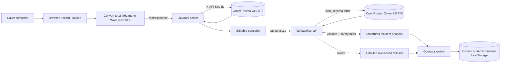
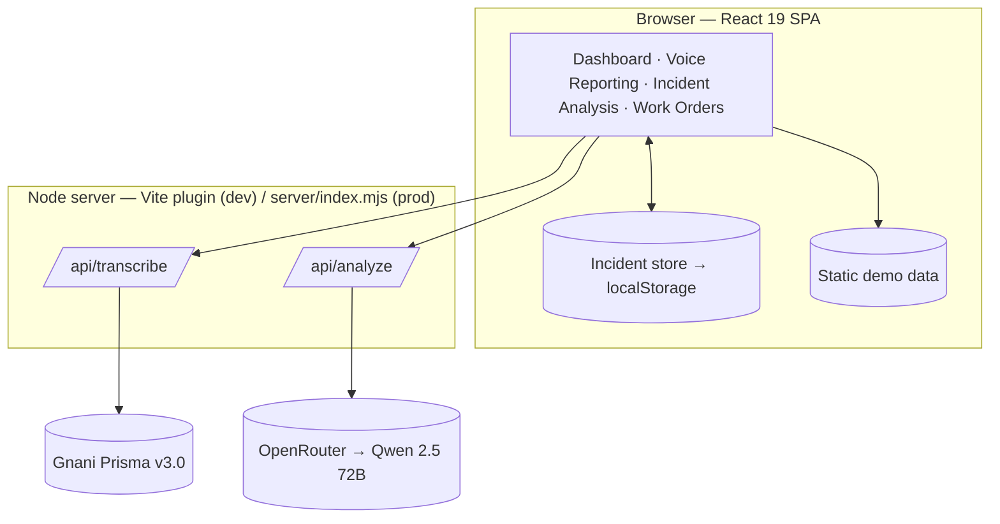

# JalVaani

**AI-powered water utility operations platform** — voice-first complaint intake and incident triage for municipal water utilities.

Built for the *Great Indian AI Internship Challenge* by Gnani AI. Hackathon prototype — **not production-ready** (see [Current limitations](#current-limitations)).

---

## Problem

Urban water utilities in India receive a constant stream of complaints — leaks, pipe bursts, no supply, low pressure, contaminated water — mostly by phone, often in Hindi or Hinglish, usually with vague locations. Control-room staff must transcribe, classify and prioritise each one and decide whether to send a crew. Mistakes cut both ways: under-rating contamination endangers public health, while dispatching crews on unverified or vague reports wastes scarce field capacity.

## Solution

JalVaani turns a spoken complaint into a structured, prioritised, **reviewable** incident in seconds:

1. The operator records (or uploads) the caller's complaint in Hindi, English or Hinglish.
2. **Gnani AI Prisma v3.0** transcribes it (code-mixed output).
3. An LLM (**Qwen 2.5 72B via OpenRouter**) extracts incident type, location, landmark, severity, supply impact, missing information and recommended actions as validated JSON.
4. Server-side rules enforce safety: evidence-based severity, no crew dispatch before verification, mandatory human review.
5. The operator reviews, creates the incident and marks it reviewed for triage.

## Key features

| Area | Features |
|---|---|
| Voice reporting | Mic recording with live waveform, 30 s auto-stop, file upload (WAV/MP3/OGG/FLAC/AAC/M4A), Hindi / English / Hindi+English selection, editable transcript |
| Speech-to-text | Gnani Prisma v3.0 via a server-side proxy; browser WebM is converted to 16 kHz mono WAV; detected language and Gnani request ID shown |
| Incident intelligence | 7 incident types, location & landmark extraction, evidence-based severity with rationale, supply impact, essential vs optional missing information, qualitative confidence |
| Safety | Verification-first actions, server-side dispatch guard, severity ceiling and illness safety floor, forced human review, clearly labelled rule-based fallback |
| Incident management | Create incidents from voice reports, filterable incident list, detail view with AI analysis, "Mark reviewed" → Triaged |
| Operations UI | Dashboard (KPIs, intake chart, zone health, priority queue), Incident Analysis charts, Work Orders table/board with crew assignment |

> Several dashboard metrics, all trend charts, zone health and work orders use **static demo data**. See limitations.

## AI architecture

| Component | Provider | Status |
|---|---|---|
| Speech-to-text | **Gnani AI — Prisma v3.0** (`POST https://api.vachana.ai/stt/v3`, `format=codemix`) | Integrated and live-tested |
| Incident analysis LLM | **OpenRouter** (third-party) → `qwen/qwen-2.5-72b-instruct`, configurable via `OPENROUTER_MODEL` | Integrated and live-tested |
| Gnani Evon v3.3 | Gnani AI | **Not integrated** — investigated but not available through the Gnani API platform at build time |

Gnani AI provides the speech layer. The reasoning layer is a third-party model accessed through OpenRouter; it is **not** a Gnani model.



### Gnani Prisma v3.0 integration
- `server/transcribe.mjs` forwards audio as multipart/form-data: `audio_file`, `model=prisma-v3.0`, `language_code` (`hi-IN`, `en-IN` or `hi-IN,en-IN`), `format=codemix`.
- The API key stays on the server (`X-API-Key-ID` header). Language codes and file extensions are whitelisted; WAV duration ≤ 30 s and size ≤ 10 MB are enforced.
- There is no mock transcription: failures are shown as errors with Retry.

### OpenRouter / Qwen integration
- `server/analyze.mjs` calls `POST https://openrouter.ai/api/v1/chat/completions` with `Authorization: Bearer $OPENROUTER_API_KEY` and `model: $OPENROUTER_MODEL` (never hard-coded).
- Checks the model exists in OpenRouter's catalogue and uses `response_format: json_schema` (strict) when supported.
- Every field is validated server-side; one automatic retry on invalid/empty output; 60 s server / 75 s client timeout.

## Voice processing workflow

1. **Capture** — `MediaRecorder` (mono, echo cancellation, noise suppression), auto-stop at 30 s; or upload a file.
2. **Convert** — decode and resample to 16 kHz mono 16-bit WAV in the browser (`src/lib/audio.ts`).
3. **Transcribe** — `/api/transcribe` → Gnani Prisma v3.0.
4. **Edit** — operator corrects the transcript if needed.

## Incident intelligence workflow

The model returns (schema excerpt):

```jsonc
{
  "incident_type": "pipe_burst",            // 7 types incl. other / unclear
  "location": "Malviya Nagar", "landmark": null,
  "severity": "medium",
  "severity_factors": [],                    // flooding, supply disruption, large population, health risk, illness, prolonged outage
  "severity_rationale": "…",
  "water_supply_impact": "unknown",
  "recommended_action": { "immediate_actions": ["…"], "after_verification_actions": ["If verified, …"] },
  "missing_information": { "essential": ["Exact location", "…"], "optional_evidence": ["Photos …"] },
  "verification_status": "reported_unverified",
  "requires_human_review": true,
  "confidence": "medium"                     // qualitative, not a probability
}
```

## Human-in-the-loop safety

Enforced by server code after schema validation, not only by the prompt:

- **Factor cross-check** — evidence the model claims but its own fields don't support is dropped.
- **Severity ceiling** — severity cannot exceed what the remaining evidence allows.
- **Illness floor** — reported illness from contaminated water is always critical.
- **Dispatch guard** — any immediate action that dispatches a crew, isolates a main or excavates without verification wording is moved to "If verified, …".
- **Human review forced** — `requires_human_review` is always `true`; every report is "Reported · unverified".
- **Fallback transparency** — if the AI fails, a keyword-based result is shown with an amber "Rule-based fallback — not AI analysis" banner and the reason.

## Work-order workflow

The Work Orders page shows demo work orders in table and board views, supports crew assignment and status progression (open → assigned → en route → on site → completed).
**Not yet implemented:** creating a work order from an incident ("Raise work order" only navigates), and persisting work-order changes.

## Getting started

### Prerequisites
- Node.js 22+ (developed on Node 26)
- A Gnani AI API key and an OpenRouter API key

### Installation
```bash
git clone https://github.com/<your-username>/jalvaani.git
cd jalvaani
npm install
```

### Environment configuration
```bash
cp .env.example .env
```
Then edit `.env`:

| Variable | Required | Purpose |
|---|---|---|
| `GNANI_API_KEY` | yes | Gnani Prisma v3.0 STT |
| `OPENROUTER_API_KEY` | yes | OpenRouter chat completions |
| `OPENROUTER_MODEL` | yes | Exact OpenRouter model id (tested: `qwen/qwen-2.5-72b-instruct`) |
| `PORT` | no | Production server port (default `8787`) |

All variables are server-side only. Do not prefix them with `VITE_`.

### Local development
```bash
npm run dev
```
Open http://localhost:5173. The API routes are served by the Vite dev server. Microphone access requires `localhost` or HTTPS.

### Production build
```bash
npm run build   # type-check + Vite build to dist/
npm start       # Node server: dist/ + /api/* on http://localhost:8787
```

## API

| Method | Path | Description |
|---|---|---|
| GET | `/api/transcribe/status` | Gnani configuration status |
| POST | `/api/transcribe?language_code=…` | Raw audio body + `X-Audio-Filename` header → transcript |
| GET | `/api/analyze/status` | OpenRouter configuration, model found, structured-output support |
| POST | `/api/analyze` | `{ transcript, detectedLanguageCode? }` → validated analysis + meta |

Errors are returned as `{ "error": { "code", "message" } }`.

## Project architecture



```
server/            transcribe.mjs · analyze.mjs · index.mjs
src/pages/         Dashboard · VoiceReporting · IncidentAnalysis · WorkOrders
src/components/    layout · ui · analysis/AnalysisPanel
src/services/      voice.ts (Gnani client, rule-based extractor) · analysis.ts (OpenRouter client, fallback)
src/store/         incidents.ts (localStorage-backed store)
src/lib/           audio.ts (WAV conversion) · format.ts
src/data/          demo.ts (static demo data)
```

## Technology stack

React 19 · TypeScript · Vite 8 · Tailwind CSS 4 · React Router 7 · Recharts · lucide-react · Node.js (`node:http`, no framework) · Gnani Prisma v3.0 · OpenRouter (Qwen 2.5 72B Instruct)

## Current limitations

- **Persistence is browser-only.** Created incidents are stored in `localStorage` on one browser; there is no database, no server-side storage and no multi-user support. Reviews of demo incidents are not persisted.
- **No authentication or authorization**, no rate limiting. The production server listens on all network interfaces — run it only on trusted networks.
- **Work orders are not connected to incidents** and changes are not persisted.
- **Static demo data** for trend charts, several KPIs (e.g. MTTR, SLA), zone health and work orders. Header search and notifications are non-functional.
- **AI latency** is about 20–35 s per analysis with the tested model.
- 30 s audio limit (Gnani REST). New incidents have no zone/geocoding.
- **No automated tests.** Verification so far is manual and scripted live testing (see `CHANGELOG.md`, `JALVAANI_PROJECT_AUDIT.md`).
- Transcripts may contain personal data and are sent to Gnani and OpenRouter; no consent, retention or data-protection controls are implemented.

## Documentation

- [`JALVAANI_PROJECT_AUDIT.md`](JALVAANI_PROJECT_AUDIT.md) — full feature inventory, architecture, testing evidence and honest assessment.
- [`CHANGELOG.md`](CHANGELOG.md) — phase-by-phase changes with live test results.
